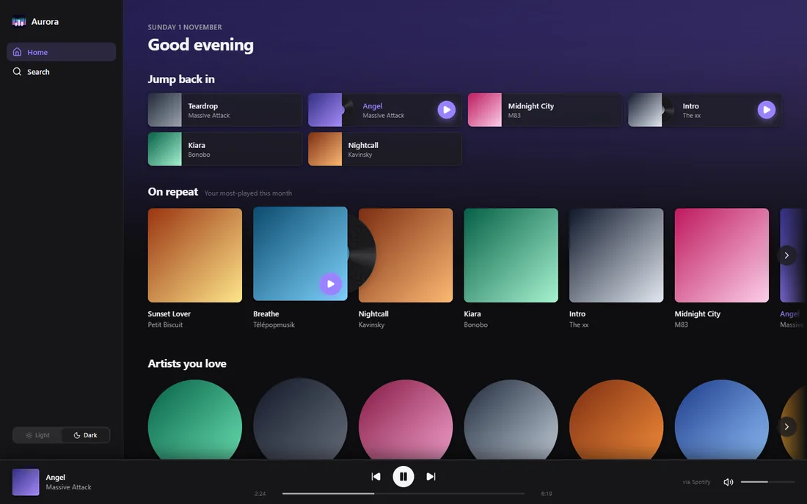

<div align="center">



[](https://github.com/Anish25012/Aurora/actions/workflows/ci.yml)


**A desktop music player with an Apple-inspired design that plays any song on Spotify, in full, inside its own interface.**

**[Try the live demo](https://anish25012.github.io/Aurora/)** (sample data, no login, no audio)



<sub>Shown with the demo page and sample data, so the album art is placeholder gradients.</sub>

</div>

## Why it exists

I wanted Spotify's catalogue with the feel of an Apple app, and a real project to learn OAuth, audio playback and desktop packaging on. It's a personal, non-commercial learning project and needs Spotify Premium.

## What it does

- **Plays full songs** through Spotify's Web Playback SDK, as its own Spotify Connect device
- **Home, Search, artist, album, playlist and podcast pages**, with library editing and a queue
- **Full-screen player** with time-synced lyrics from LRCLIB
- **Discovery** (radio and mixes) from Last.fm, with an optional free key
- **Light and Dark themes** with a circular reveal, and keyboard shortcuts
- **A Windows desktop app** with its own icon, tray icon and crash recovery

## The engineering

| Problem | What I did |
| --- | --- |
| A browser app can't keep a client secret | OAuth 2.0 PKCE with no backend, checked against the RFC 7636 example in the tests |
| Parallel requests could invalidate a rotating refresh token | They all wait on one shared token refresh |
| A playing song redrew the whole app 4 times a second | A playback clock so only the progress bar and lyrics tick: 3.5% CPU down to about 0.1% |
| Stock Electron has no Widevine DRM, which Spotify needs | Chrome app-mode windows, with a hidden engine window controlled over a `BroadcastChannel` |
| Crashed players could pile up unseen | A launcher that cleans up at start, watches a heartbeat and restarts the engine |

**Testing:** 197 unit and component tests (Vitest and Testing Library), plus 13 end-to-end desktop checks, including a simulated player crash.

## Try it

You'll need Node.js 20+, Spotify Premium and a free app in the [Spotify Developer Dashboard](https://developer.spotify.com/dashboard). Full setup is in the [player README](player/README.md).

```bash
cd player
npm install
npm run dev
```

## What's in here

| Folder | What's in it |
| --- | --- |
| [`player/`](player/README.md) | The app: React, TypeScript and Vite. Setup, features and architecture are in its README. |
| `desktop/` | The Windows desktop app: launcher, tray icon, shortcuts and the app icon. |
| `start_aurora.bat` | Runs the player with hot reload, for development. |
| `archive/python-assistant/` | The first prototype, an LLM assistant for Spotify, kept for reference. Not used by the player. |

Built by [Anish Joshi](https://github.com/Anish25012). Not affiliated with or endorsed by Spotify.
