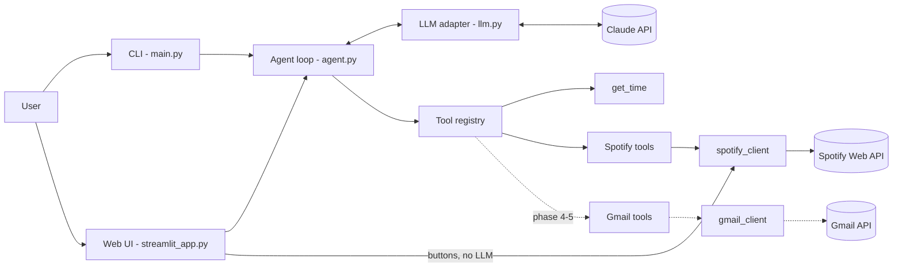

# Aurora: an LLM personal assistant for Spotify and Gmail

> **Project direction has changed.** The main app is now **[Aurora Player](player/README.md)** (`player/`): a standalone music player with an Apple-inspired design that plays full songs from Spotify, with Gmail coming as a second tab. It needs no AI. The Python assistant below is the earlier prototype and is kept for reference.

Aurora is a web and command-line assistant that handles everyday requests in plain English: *"play something chill"*, *"summarise my unread emails from today"*, *"find the newsletter that mentioned a new album, then add it to my library"*. Aurora doesn't match requests against hard-coded intents. It gives Claude a set of typed tools and lets the model choose which ones to call, in what order, and then answer. A safety layer decides what actually runs: risky actions need explicit confirmation, and email content is treated as untrusted.

> **Status:** Phases 1–3 and the web UI (originally phase 7, built early) are done. Spotify works end to end: what's playing, search, your top and recent tracks, play/pause/skip, creating and adding to playlists, and saving to your library. Large playlist changes need your approval first. Gmail is next.

<!-- TODO (phase 8): demo GIF -->


## Architecture



## Quickstart

Requires Python 3.11+ and an [Anthropic API key](https://console.anthropic.com/settings/keys).

```bash
python -m venv .venv
# Windows: .venv\Scripts\activate    macOS/Linux: source .venv/bin/activate
pip install -e ".[dev]"
cp .env.example .env        # then set ANTHROPIC_API_KEY
python -m assistant.main    # terminal chat (or just: aurora)
streamlit run assistant/ui/streamlit_app.py   # web UI at http://127.0.0.1:8501
```

### Web UI

- **Left:** what's playing, with cover art, progress, ⏮ ⏯ ⏭ controls and up next. Below that is a quick search with ▶ Play and ➕ Queue buttons. These call Spotify directly without the AI, so they're instant and cost nothing.
- **Right:** chat with Aurora. Each answer has a "🔧 tool calls" panel showing what ran, with arguments and timings. Risky actions show **Approve / Cancel** buttons, and nothing happens until you click one.
- **Local only:** the server listens on `127.0.0.1` only (set in `.streamlit/config.toml`). Streamlit's default is every network interface, which would let anyone on your Wi-Fi control your account.

Aurora is a **remote control with an assistant built in**. It is not a replacement for the Spotify app, and audio still plays through Spotify on your phone, computer or speaker. That's deliberate: Spotify's [Developer Policy](https://developer.spotify.com/policy) (III.11) forbids apps that replicate or replace Spotify's core experience, and requires cover art and links back to Spotify wherever its content is shown (II.4–II.5).

Try: `what time is it?`, `what time is it in Tokyo and New York?`, `what's the time on Mars?` (this one shows error recovery).

CLI commands: `/reset` clears the conversation, `/help` lists commands, `/quit` exits.

## Spotify setup

Spotify is optional. If you leave the credentials out, Aurora runs without the music tools.

1. Go to the [Spotify Developer Dashboard](https://developer.spotify.com/dashboard), log in, and click **Create app**.
2. Fill in the form:
   - **App name / description:** anything, e.g. "Aurora".
   - **Redirect URI:** `http://127.0.0.1:8888/callback`. Click **Add**. It must be `127.0.0.1`, because Spotify rejects `localhost`.
   - **Which API/SDKs are you planning to use?** Tick **Web API**.
   - Accept the terms and click **Save**.
3. Open the app's **Settings** and copy the **Client ID**. Click **View client secret** and copy that too. Put both in `.env` as `SPOTIFY_CLIENT_ID` and `SPOTIFY_CLIENT_SECRET`.
4. Under **User Management**, add the name and email of the Spotify account you'll use. New apps run in *Development Mode*, which only allows up to 5 listed users. If you skip this step, you'll get 403 errors.
5. Run Aurora. On the first run, a browser tab asks you to approve access. After that the token is cached in `.spotify_cache` (git-ignored) and refreshes automatically.

**Spotify scopes requested**

| Scope | Needed for |
|---|---|
| `user-read-playback-state` | `get_current_playback`, and finding an idle device to play on |
| `user-read-currently-playing` | Web UI "up next" list (`GET /me/player/queue` requires it) |
| `user-modify-playback-state` | `play`, `add_to_queue`, `pause`, `skip_next`, `skip_previous` |
| `user-top-read` | `get_top_items`: your top tracks and artists |
| `user-read-recently-played` | `get_recently_played` |
| `playlist-read-private` | `get_my_playlists`: so it can find your private playlists, e.g. "Focus" |
| `playlist-modify-private` | `create_playlist` (private by default), `add_to_playlist` |
| `playlist-modify-public` | `add_to_playlist` on public playlists, and public `create_playlist` |
| `user-library-modify` | `save_to_library` |

`search` needs no scope. Aurora asks only for the scopes its current tools use. When a later phase adds a scope (e.g. playback control), Spotify asks you to approve again, so the user can see that the app wants more access.

Not requested: email, profile details, followers or listening activity of other users. Playback control (`play`/`pause`/`skip`) also needs **Spotify Premium** and a device with Spotify open.

**Spotify API restrictions this project works around.** Spotify has twice limited what new Development Mode apps can do ([Nov 2024](https://developer.spotify.com/blog/2024-11-27-changes-to-the-web-api), [Feb 2026](https://developer.spotify.com/documentation/web-api/references/changes/february-2026)). Recommendations, audio features, related artists, browse/new releases, artist top tracks and Spotify's own editorial/algorithmic playlists are **not available**, and search returns **at most 10 results** per request. Aurora uses only endpoints that are still available. "Make me a gym playlist" will be built from your top and recent tracks plus targeted searches, not from the recommendations endpoint. The app owner also needs **Spotify Premium** for a Development Mode app to work.

## Example requests

| You type | What Aurora does |
|---|---|
| "What's playing?" | `get_current_playback` |
| "Play something chill" | `search` for a fitting playlist or tracks → `play` |
| "Play Teardrop by Massive Attack" | `search` → `play` (starts straight away) |
| "Queue Angel next" | `search` → `add_to_queue` |
| "Skip this" / "Pause" / "Go back one" | `skip_next` / `pause` / `skip_previous` |
| "Who have I been listening to most this month?" | `get_top_items` (artists, short_term) |
| "Add this song to my Focus playlist" | `get_current_playback` → `get_my_playlists` → `add_to_playlist` |
| "Make me a 20-song gym playlist based on what I listen to" | `get_top_items` + `get_recently_played` + `search` → `create_playlist`. You see all 20 tracks and approve (y/n) before anything is created |
| "Save this album" | `get_current_playback` → `save_to_library` |

## Safety model

Some actions change your data. These go through a **confirmation gate** ([`assistant/safety.py`](assistant/safety.py)):

- **What needs approval:** any playlist change involving more than `PLAYLIST_CONFIRM_THRESHOLD` tracks (default 10). From phase 5, sending an email will too. Small edits like "add this song to Focus" run straight away.
- **What you see:** exactly what will happen. That means the playlist name, whether it's public or private, and every track by name. URIs are labelled from results Aurora has already fetched, and anything unknown is looked up. A URI the model invented shows up as "couldn't look this up – may not exist", so you'd spot it before approving.
- **Only `y` or `yes` approves.** Enter, `n`, Ctrl+C or anything else cancels, and the model is told the user declined.
- **The model can't bypass it:**
  - The check runs in the tool registry, in Python, between "the model asked for a tool" and "the tool runs".
  - Approval isn't something the model can pass in. Every tool rejects unknown arguments, so adding `"confirmed": true` just fails validation (this is tested).
  - Whether an action is risky is decided by rules in code, not by asking the model.
- **It fails closed:** the registry's default confirmer denies everything, so a new front end can't accidentally run risky actions without asking. In the web UI, a prompt nobody answers within 5 minutes counts as declined.
- **Same gate in both interfaces.** The CLI asks y/n in the terminal. The web UI runs the agent on a worker thread, which waits inside the confirmer until a button is clicked (`BlockingConfirmer`). The agent loop doesn't know or care which interface it's in.

## Configuration

All settings come from environment variables, which can be set in `.env`. See [`.env.example`](.env.example).

| Variable | Default | Purpose |
|---|---|---|
| `ANTHROPIC_API_KEY` | (required) | Anthropic API key |
| `ASSISTANT_MODEL` | `claude-sonnet-5-5` | Claude model |
| `ASSISTANT_EFFORT` | `medium` | Thinking effort: `low` … `max` |
| `MAX_TOOL_ITERATIONS` | `10` | Tool rounds allowed per request |
| `ASSISTANT_REFUSAL_FALLBACK` | `true` | Retry declined requests server-side on a fallback model |
| `USER_TIMEZONE` | `Europe/London` | Used for "today", "Friday", etc. |
| `SPOTIFY_CLIENT_ID` / `SPOTIFY_CLIENT_SECRET` | (optional) | From the Spotify dashboard |
| `SPOTIFY_REDIRECT_URI` | `http://127.0.0.1:8888/callback` | Must match the dashboard exactly |
| `PLAYLIST_CONFIRM_THRESHOLD` | `10` | Playlist changes above this many tracks need y/n (0 = always) |

## Project layout

```
assistant/
  main.py          CLI entry point (rich)
  agent.py         tool-use loop, history, iteration cap
  llm.py           the only module that talks to the Anthropic SDK
  config.py        typed settings from .env
  errors.py        ToolError: expected failures with user-facing messages
  safety.py        confirmation gate (PendingAction, fail-closed default)
  tools/
    registry.py      name -> function + pydantic schema; validation; error handling
    basic_tools.py   get_time
    spotify_tools.py Spotify tool schemas and descriptions
  clients/
    spotify_client.py  OAuth, response shaping, Spotify error translation
  ui/
    streamlit_app.py   web UI: now playing + controls + chat
    background.py      runs an agent turn on a worker thread
tests/             pytest suite; the model is faked, so no network is needed
```

## Running tests

```bash
pytest
```

The agent tests use a scripted fake model, so they need no API key or network and give the same result on every run.

## Design decisions (so far)

- **Tool use instead of hard-coded intents.** New capabilities are added as tools, not as new parsing rules, and the model can chain tools for multi-step requests.
- **One pydantic model per tool.** The model generates the JSON schema sent to Claude and also validates the arguments Claude sends back, so the two can't drift apart. Invalid arguments go back to the model as an `is_error` result, and it usually fixes them on its next try.
- **Manual agent loop.** Writing the loop by hand lets the app cap iterations, record every tool call for logging, and (from phase 5) stop for user confirmation before risky actions.
- **Iteration cap with a graceful ending.** After `MAX_TOOL_ITERATIONS` rounds, the agent makes one last call with `tool_choice: none`. The model then has to answer with what it has, so the user always gets a reply.
- **Turn-level rollback.** If a request fails partway (network error, refusal), the history is restored to how it was before the request. A half-finished turn would make every later request in the session invalid.
- **Shaping API responses before the model sees them.** A raw Spotify track object includes image URLs, market lists and links, and runs to thousands of characters. The client trims it to name, artists, album, duration and URI. That uses fewer tokens and leaves the model less noise to misread.
- **Errors written for the model.** Spotify errors are turned into messages that suggest a fix (a 403 says "add yourself under User Management"), so the assistant can tell the user what to do instead of just reporting a status code. 429s fail fast rather than retrying, because Spotify's `Retry-After` can be long enough to freeze the chat.
- **Playing on an idle device.** Spotify only sends commands to an *active* device. If Spotify is open but idle on your laptop, a play command fails with "no active device". In that case Aurora looks for an available device and plays there, so you don't have to tap play yourself first.
- **Honest partial failures.** If a playlist is created but adding tracks fails, the error says so and gives the new playlist's URI. The model can then retry the add instead of creating a duplicate playlist.
- **Log in at startup.** If Spotify needs a browser login, it happens when Aurora starts, not partway through answering a request.
- **Cache-friendly system prompt.** The system prompt contains today's date but not the time, so it stays the same all day. The exact time comes from the `get_time` tool.

## Known limitations

- **Spotify Development Mode.** Up to 5 users, each added by hand in the dashboard, and the app owner needs Premium. Playback control needs Premium plus a device with Spotify open.
- **No recommendations endpoint.** "Something chill" relies on search and your listening history, so results depend on how good the search queries are.
- **Spotify Developer Policy III.14** prohibits ingesting "Spotify Content into a machine learning or AI model". Aurora never trains on, stores or caches Spotify data. It only shows a few metadata fields (track names, artists) to Claude for the request being answered. Whether that counts as "ingesting" isn't clarified in Spotify's docs; their AI guide only explicitly bans training. Treat this as a personal, non-commercial project, and ask Spotify before doing anything wider with it.

*More to come: Gmail, OAuth scope notes for Google, logging and analytics.*
